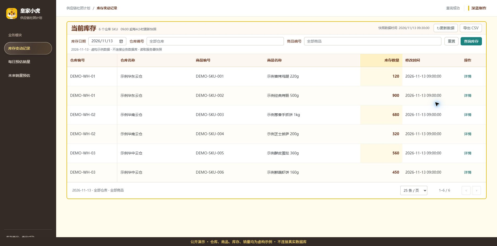
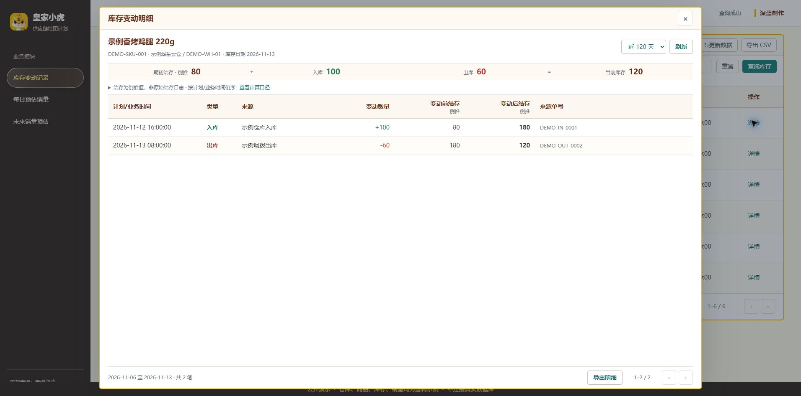
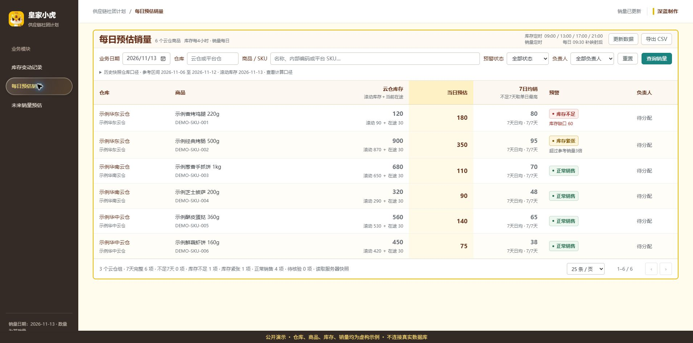
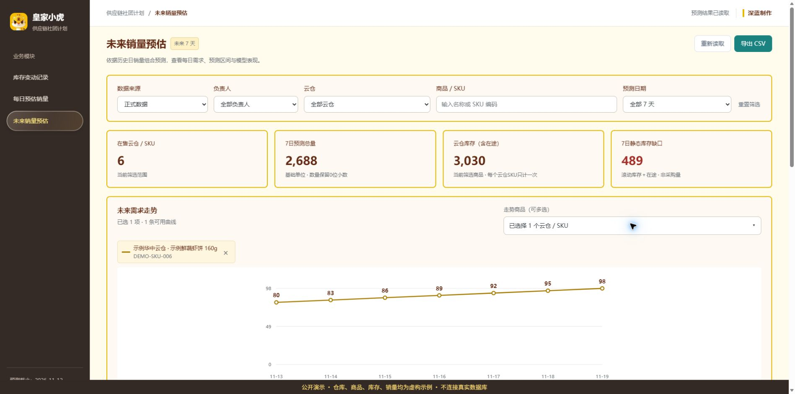
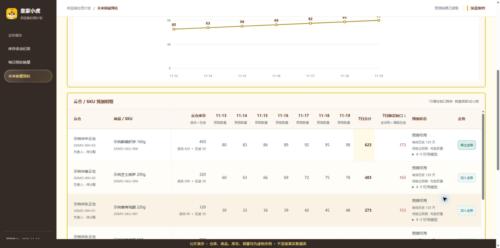

# 供应链社团计划 · 皇家小虎

面向云仓运营的桌面 Web 看板，将库存流水、当日销量预估与未来七日需求预测放在同一工作台。采用皇家小虎品牌元素，突出数据表格、筛选与业务预警。

**Node.js 原生 HTTP · HTML/CSS/JavaScript · Python · PostgreSQL · Doris**

> 以下页面使用完全虚构的示例数据：仓库、商品、编码、库存、销量和单据均非真实业务记录。截图由独立的本地演示服务渲染，每页都有醒目的演示标识。仓库不包含真实业务快照、数据库凭据或 n8n 密钥。

## 零配置查看所有页面

安装 Python 3.11+ 后，无需数据库、Node 或模型依赖即可运行：

```powershell
python scripts/serve_demo.py --port 8892
```

打开 `http://127.0.0.1:8892`，即可查看三个模块和库存详情。此服务只返回脚本内生成的虚构示例，不导入数据库模块，不读取真实库存或销量；它用于页面演示，不用于验证预测准确率。

## 页面一：库存变动记录

按仓库＋内部 SKU 展示库存，支持日期、仓库与商品筛选、手动更新和 CSV 导出。当前库存采用既有 SQL 口径；历史库存读取固定日快照，避免回查结果随实时库存变化。



点击详情查看出入库流水、来源与单据。结存按当前库存及可见流水倒推，明确标注为倒推结果，不能视为原始结存日志。计划/业务时间按业务口径展示。



## 页面二：每日预估销量

表格按照 **仓库 → 商品 → 云仓库存 → 当日预估 → 7日销量参考 → 预警 → 负责人** 排列。支持仓库、SKU、预警状态和负责人筛选，库存不足优先展示。



- 云仓库存＝滚动当日库存＋采购在途＋调拨在途；滚动当日库存＝实时库存－待出库＋待入库。
- 参考所选日期之前7个自然日，先按批准的云仓映射合仓、按内部 SKU 倍率换算，再逐日汇总。满7天取日均，不足7天取已有单日最高，缺失记录不当零。
- 红色：当日预估大于库存；黄色：预估大于参考销量3倍且小于库存；其他数据完整记录为绿色。等于阈值不触发对应严格不等式；必要数据缺失时待核验。
- 库存北京时间 **09:00 / 13:00 / 17:00 / 21:00** 更新；外部采集09:00，独立 SKU 补映射09:30完成后刷新销量快照，销量按日读取。
- 普通访问和筛选读取服务器持久快照；源查询失败保留上次有效数据，不将整库异常显示为零库存。

## 页面三：未来销量预估

按云仓＋内部 SKU 预测未来7天。包括库存关联、逐日预测、7日合计、静态库存缺口、负责人筛选及可选商品趋势对比。





Python 引擎组合 SARIMAX、Holt-Winters、LightGBM 与 TSB，支持扩展窗口回测、历史 OOF 权重及逐模型失败回退。正式训练至少90个有效观测日；缺日保留缺失，不自动填零。正式与演示产物隔离。

**预测为试运行能力：已有验证未证明组合优于基准；新增云仓 SKU 未全部完成独立回测。静态库存缺口不是采购数量，缺少交期、MOQ、包装及分批到货参数时阻断采购建议。** 点击“重新读取”只读取已生成结果，不重新训练。

## 项目结构

```text
index.html / *-view.js / *.css      三个页面与品牌样式
server.js                         HTTP 服务与现有鉴权
inventory_api.js                   库存及出入库接口
daily_sales_api.js                 每日预估与库存预警
future_sales_api.js                预测批次读取
future_sales_inventory.js          预测与库存快照关联
dashboard_snapshot_*.js            持久快照及定时更新
sql/                              只读取数 SQL、SKU 映射口径
config/                           批准的仓库对应配置
scripts/                          查询、归档、启动与验证脚本
sales_forecasting/                Python 预测引擎、配置和测试
docs/screenshots/                 使用虚构示例数据的页面截图
```

本仓库将原本分布在两个本地目录的网站与预测引擎整合在一起。原数据库、n8n 工作流、Windows 计划任务和业务快照不是 Git 仓库的一部分。

## 本地运行（PowerShell）

要求 Node.js 20+、Python 3.11+；真实数据需要有权访问 PostgreSQL/Doris，并配置只读数据库账号。

```powershell
python -m venv .venv
.\.venv\Scripts\python.exe -m pip install -r requirements.txt
.\.venv\Scripts\python.exe -m pip install -e './sales_forecasting[test]'
$env:INVENTORY_PYTHON = (Resolve-Path .venv\Scripts\python.exe).Path
$env:PICKUP_WEB_HOST = '127.0.0.1'
$env:PICKUP_WEB_PORT = '8791'
# 按 .env.example 将 PG* / DORIS_* 配置为本机环境变量。
# .env.example 是变量说明，服务不会自动加载此文件。
npm start
```

浏览器打开 `http://localhost:8791/#inventory`；另有 `#daily-sales`、`#future-sales`。无凭据时页面可打开，真实查询不可用。服务会自动启动既有快照调度；调度进程需要持续运行，外部 n8n 调度不会由 npm start 创建。

### 先体验预测演示

另开终端，在仓库根目录运行：

```powershell
.\.venv\Scripts\python.exe -m sales_forecasting.cli make-demo-data --config sales_forecasting/configs/demo.yaml
.\.venv\Scripts\python.exe -m sales_forecasting.cli run-all --config sales_forecasting/configs/demo.yaml
```

进入未来销量页，数据来源切换为“演示数据”。演示产物仅本地生成，不能当真实业务销量。

### 接入真实预测

配置数据库后运行 `scripts/import_sales_pg.py`，首次先按正式配置执行 `run-all` 建立有效 OOF 审计批次。之后可用 `forecast-active` 更新当前商品预测。首次完整回测可能耗时较长，详见 [预测引擎说明](sales_forecasting/README.md)。未来预测目前没有新增自动训练计划。

### 验证

```powershell
node --test scripts/test_*.cjs
.\.venv\Scripts\python.exe -m pytest sales_forecasting/tests -q
```

`verify_daily_sales_*.py` 部分脚本会读取真实数据库，应在配置只读凭据后运行。

## 数据与凭据边界

PG 来源为 `scrape_data.public.pdd_order_today`、`public.pdd_sales_data`、独立映射 `public.community_plan_sku_mapping`。仓库对应由批准的 Excel 导入配置；新增仓库不能仅凭相似名字猜测。生产 SKU 映射表不由本网站改写。独立补映射及采集流程由外部 n8n 提供，本仓库不携带其密钥。

库存归档与持久快照默认位于运行用户的本地应用数据目录；预测输入和产物写入 `sales_forecasting/data/`、`sales_forecasting/artifacts/`，均已加入 `.gitignore`。新机器需要重新配置数据库并生成数据，克隆源码不会带走原机器历史档案。

默认本地启动说明绑定回环地址。需要对外提供服务时，应配置既有鉴权、访问范围和 HTTPS；公开此源码仓库不会发布或部署业务网站。

业务规则和实现细节见 [库存说明](docs/inventory_web.md)、[每日销量说明](docs/daily_sales_web.md)、[预测引擎说明](sales_forecasting/README.md)。品牌素材用于本项目展示，仓库公开不代表另行授予商标或素材使用权。
